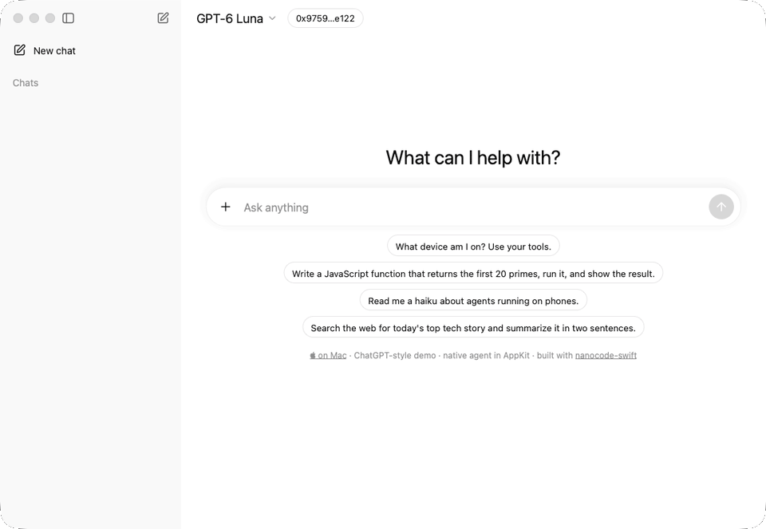
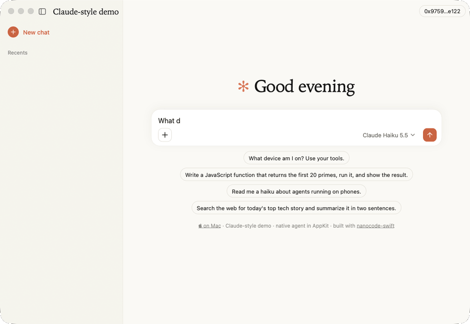
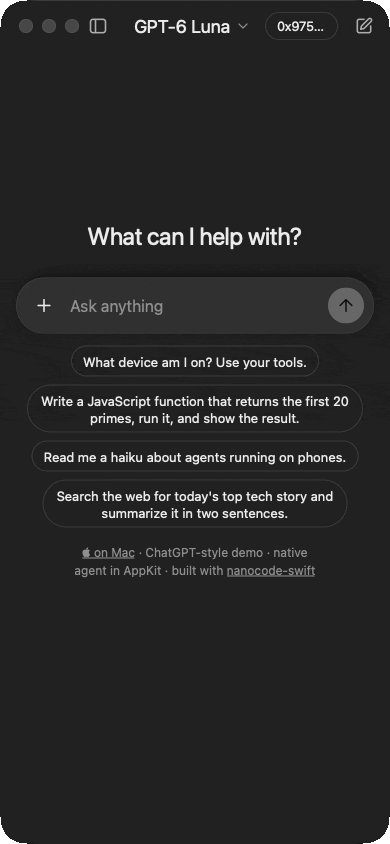
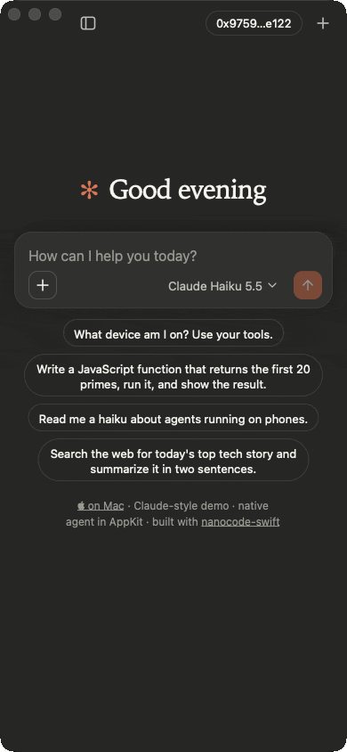

# nanocode-swift

The [nanocode](https://nanocode.xyz) agent SDK on Apple platforms: Claude and Codex agents that run natively inside a macOS or iOS app, with durable sessions in a local SQLite file, Code Mode cells in an embedded QuickJS, device tools, hands and runners, and models and tools paid per request from a Tempo Wallet over MPP. It is the Swift sibling of [nanocode-ts](https://github.com/gakonst/nanocode-ts): the same SDK, compiled into a static library instead of WebAssembly, with its UI written in AppKit and UIKit.

<table>
  <tr>
    <td></td>
    <td></td>
  </tr>
  <tr>
    <td align="center">ChatGPT style · GPT-6 Luna runs a Code Mode cell</td>
    <td align="center">Claude style · Claude Haiku 5.5 calls a device tool</td>
  </tr>
</table>

<table>
  <tr>
    <td></td>
    <td></td>
    <td>The same views at 390 points wide, in dark mode: the sidebar becomes a drawer, the header gains its sidebar and new-chat buttons, and the bubbles, hero and composer follow the clones' mobile layout. Each recording is the demo app with a real model, paid from a Tempo CLI wallet.</td>
  </tr>
</table>

## Products

| Product | What it is |
| --- | --- |
| `Nanocode` | The runtime over the Rust library: `NanocodeRuntime`, `Session`, `Chat`, `Wallet` and `WalletMonitor`, hands, runners and the model catalog. |
| `NanocodeKit` | Native AppKit (macOS) and UIKit (iOS) UI from one source: `CloneViewController` with the ChatGPT and Claude skins of nanocode-ts's clone apps, and `NanocodeChatViewController` for a conversation in your own window. |
| `NanocodeCore` | Plain Swift, no Rust: events, the paced `Transcript`, tool cells, turns, the markdown parser and syntax highlighter, for apps that render nanocode events they receive some other way. |
| `NanocodeViews` | SwiftUI views over `NanocodeCore`, for SwiftUI hosts. |

`Package.swift` downloads the prebuilt `NanocodeFFI` XCFramework that `ffi-release.json` names, so depending on the package builds no Rust.

## Quickstart

```swift
import NanocodeKit

let runtime = try NanocodeRuntime.standard(named: "My App")
let session = try await runtime.open(SessionConfiguration(provider: .claude, model: "claude-haiku-5-5"))
let chat = Chat()
await chat.attach(session)

let controller = NanocodeChatViewController(chat: chat, skin: .claude)
```

With no API key configured, sessions pay through the connected Tempo Wallet (`WalletMonitor.connect()`, or `useTempoCLI()` on macOS). `SessionConfiguration` also takes instructions, host tools (`HostTool`), a workspace directory, MCP servers and hands.

## Examples

- `Examples/Demo` is the nanocode.xyz demo: an AppKit app for macOS and a UIKit app for iOS, in the ChatGPT or Claude style, with conversations from the store, the model menu, a Tempo Wallet, device tools (`device_info`, `open_url`, `clipboard`, `speak`), a computer attached through the relay and this device as a hand. Run `xcodegen generate` in it and open `NanocodeDemo.xcodeproj`.
- `Examples/Demo/AppKit` and `Examples/Demo/UIKit` are the smallest hosts: an `NSWindow` and a `UINavigationController` around `NanocodeChatViewController`.
- `Examples/Console` is a terminal client, and `Console hand <url> <token>` makes the process a hand.

## Building the library

`scripts/build-ffi.sh` builds the Rust crate in `src/` against the SDK at `sdk-revision.json` (a checkout of [nanocodex](https://github.com/gakonst/nanocodex) beside this one) and writes `build/NanocodeFFI.xcframework`, which the package then uses instead of the release.

## License

MIT or Apache-2.0.
